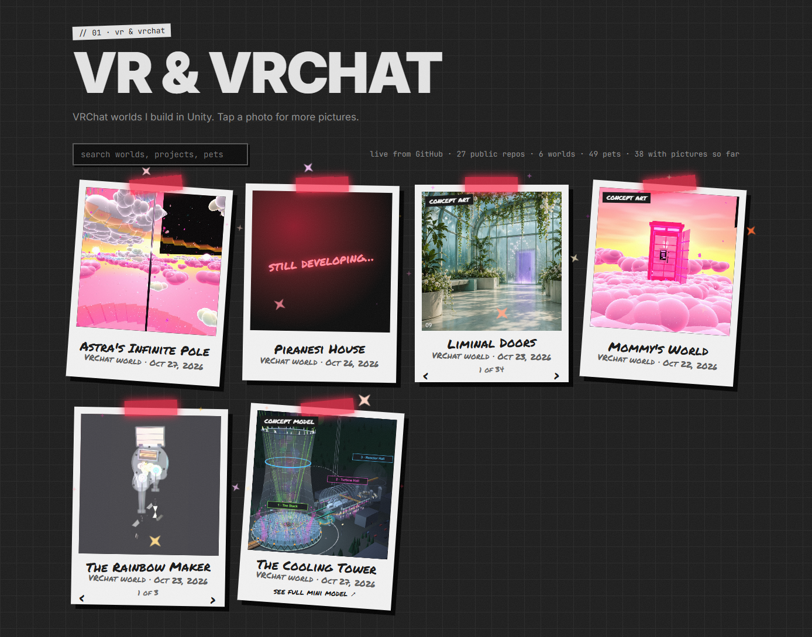

# findastra.github.io

*By Astra.* Every VRChat world, Discord project, web tool and pet in one place, live from GitHub.

## The Site

Each public project is a Polaroid, grouped the way the GitHub profile groups them. Tap one for more pictures.

**[▶ Open findastra.github.io](https://findastra.github.io)**

**Needs:** a browser.

### What's on it

| Section | What it shows |
| --- | --- |
| Top | A terminal you can type into, Astra's hand lettering, and two tickers: live updates and what she is working on. |
| VR & VRChat | Her VRChat worlds as Polaroids. |
| Discord | Discord add-ons and presence cards. |
| Web & More | Every other public repo: websites and tools. |
| Astra's PetOS | The star jar: shake it and one pet's star window falls out, or tip it out to see them all. |
| Arcade | Small games, among them the Fuzzboi Factory and the sparkle catcher. |
| Contact | How to reach Astra. |

## Quirks

1. Work history is empty until Astra approves each employer page.
2. The hero shows Astra's hand lettering, 8 pieces so far; Portfolio Puffer's Handwritten Message Manager keeps the set.
3. Every project card shows its repo's own committed pictures first (35 repos pass Flash Audit A55 so far), then
   live-site screenshots; program-page screenshots fill in for repos that have not committed pictures yet. A card with
   no picture yet says "still developing…".
4. Projects load live from the GitHub API; when it does not answer, the page uses the snapshot in `site-data.js` and
   says so.

## Developer Notes

1. **Kept by Portfolio Puffer** ([portfolio-puffer](https://github.com/findastra/portfolio-puffer)). Portfolio Puffer
   proposes changes; Astra approves them. Rules and the file map: [AGENTS.md](AGENTS.md).
2. **The one place that connects Audra and Astra** (Astra, 2026-10-17; see `findastra/astras-pet-os`
   skills/farm-security). Employer pages publish only what Astra has read word for word.
3. **Run it locally:** `python -m http.server 5173` in this folder, then open <http://localhost:5173>. Earlier design
   drafts: `/drafts/`.
4. **Static, no build:** GitHub Pages serves `main` as it is.
5. **Rules and handoffs:** [CLAUDE.md](CLAUDE.md) and [AGENTS.md](AGENTS.md).

## Credits

1. Built with Claude Code (Claude Opus 5.5), from 2026-10-17. Every session is listed in the "Built with" lines in
   [AGENTS.md](AGENTS.md).
2. The hand lettering is Astra's own, drawn in Procreate.
3. The picture above is a screenshot of the live site, 2026-10-29.

## License

MIT, see [LICENSE](LICENSE).
